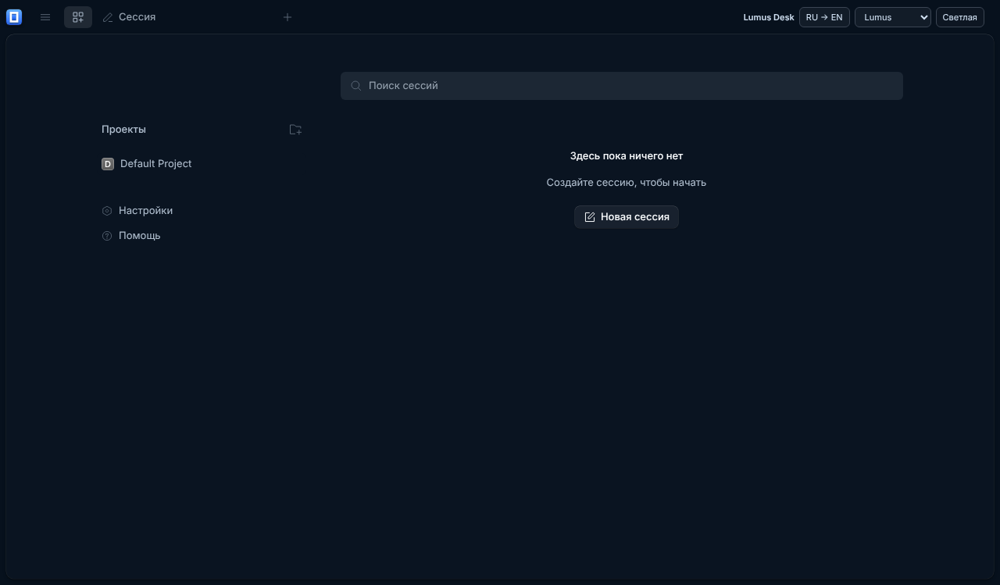
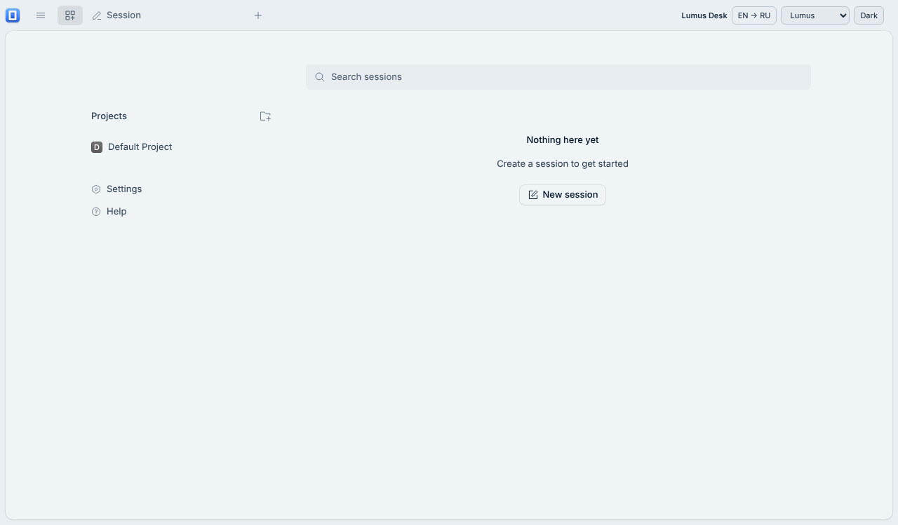

# Lumus Desk

Early Linux-first desktop patch **based on OpenCode**, not an official OpenCode distribution. This repository contains patches, not the full upstream source or an installer.

Base: https://github.com/anomalyco/opencode
Exact commit: `80d43eb7073da9b1763840eb2e1ba778064e2ee3`
License: MIT. OpenCode's copyright and MIT notice are preserved in LICENSE.

## Apply on Linux

Requires git, tar, Bun and Node.js, plus Electron's Linux desktop dependencies. Run as your normal user, not root.

```sh
git clone https://github.com/Lumus-ai/lumus-desk.git lumus-desk-patch
git clone https://github.com/anomalyco/opencode.git lumus-desk-source
cd lumus-desk-source
git checkout 80d43eb7073da9b1763840eb2e1ba778064e2ee3
git apply ../lumus-desk-patch/lumus-desk.patch
tar -xzf ../lumus-desk-patch/new-files.tgz
bun install --frozen-lockfile
cd packages/desktop
node node_modules/electron/install.js
bun ./scripts/copy-icons.ts dev
export OPENCODE_CHANNEL=local
export OPENCODE_VERSION=2.0.0-lumus-local
export OPENCODE_DESKTOP_SERVER_CHANNEL=local
export OPENCODE_DESKTOP_CLI_DEV="$(cd ../cli && pwd)"
export LUMUS_LOW_MEMORY_DEV=1
node node_modules/electron-vite/bin/electron-vite.js dev
```

The steps above describe the local Linux launch path; no Arch package or AppImage/deb is supplied yet. Windows is secondary and untested. Keep the normal Electron sandbox enabled.

## Verified / unfinished

Verified in a Linux Electron dev window: RU/EN button changes visible UI strings; theme picker and light/dark change the visible interface; Lumus theme; separate desktop identity and data; localhost backend startup. Nine scoped theme tests and UI package typecheck passed.

Not a finished release: production bundling failed due to a 2 GB environment; full desktop/app typechecks did not finish; the broad UI suite had three JSX-runtime errors. Terminal palette and full restart persistence are not yet checked. Custom-command editor, brain/hands, automated web chat connections and packaged installers are not implemented. Upstream updater disabled. No workflows or keys in this patch repo.

## Real Linux development screenshots




